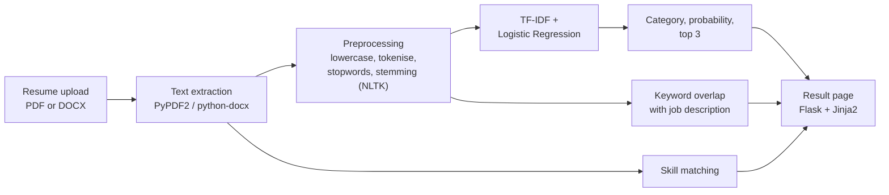

# ResuMatch — Resume Classification Web App

A Flask web app that reads a resume (PDF or DOCX), predicts which of 25 job categories it belongs to, lists the skills it mentions and measures the keyword overlap with a job description. The classifier is a TF-IDF + Logistic Regression model trained with scikit-learn.

**Live demo:** https://resumatch-8dk2.onrender.com (deployed on Render)

Team project (two students) for the module Big Data Programming: Python Project, MSc Applied Data Science and Analytics, SRH University of Applied Sciences Heidelberg (Hamburg campus), March 2025.

## At a glance

| | |
|---|---|
| **Task** | Text classification of resumes into 25 job categories |
| **Data** | Kaggle "Updated Resume Dataset": 962 rows, of which 166 are unique resumes |
| **Model** | TF-IDF (unigrams and bigrams) + Logistic Regression |
| **Result** | 85% accuracy and 0.80 macro F1 (3-fold cross-validation on the 166 unique resumes) |
| **Stack** | Python, Flask, Gunicorn, scikit-learn, NLTK, pandas, PyPDF2, python-docx, pytest, Bootstrap |
| **Tests** | 35 automated tests (pytest) |

## What the app shows

For an uploaded resume and a job title and description, the result page shows:

- the predicted job category and its probability, plus the three most likely categories;
- the skills found in the resume, from a fixed list of 26 skills (whole-word matching, including multi-word skills such as "machine learning");
- the keyword overlap: the share of distinct job-description keywords (after cleaning) that also occur in the resume.

The app does not rank, shortlist or reject candidates.

## How it works



1. **Extraction.** The upload is saved to a temporary file, read with PyPDF2 or python-docx, and always deleted afterwards, also when processing fails.
2. **Preprocessing.** Lowercasing, removal of non-letters, tokenisation, stopword removal and Porter stemming with NLTK. Training and prediction use exactly the same steps.
3. **Classification.** A TF-IDF vectoriser (unigrams and bigrams, up to 10,000 features) and a Logistic Regression model (class-balanced). The trained pipeline is loaded once when the app starts.

## Data and evaluation

The [Updated Resume Dataset](https://www.kaggle.com/datasets/jillanisofttech/updated-resume-dataset) has 962 rows in 25 categories, but only **166 rows are unique**: 796 are exact copies of other rows. The smallest categories have only 3–4 unique resumes, so cross-validation uses 3 stratified folds on the 166 unique resumes.

| Model (3-fold CV, 166 unique resumes) | Accuracy | Macro precision | Macro recall | Macro F1 |
|---|---|---|---|---|
| Multinomial Naive Bayes (original model) | 0.36 ± 0.05 | 0.22 ± 0.02 | 0.25 ± 0.04 | 0.21 ± 0.03 |
| **Logistic Regression (deployed)** | **0.85 ± 0.03** | **0.80 ± 0.05** | **0.84 ± 0.03** | **0.80 ± 0.03** |
| Linear SVM | 0.87 ± 0.03 | 0.83 ± 0.06 | 0.86 ± 0.02 | 0.82 ± 0.04 |

- **Why Logistic Regression and not the Linear SVM:** the SVM scored slightly higher but gives no probabilities, and calibrating it is not possible with only 2 resumes per class in some training folds.
- **Tuning:** a grid search over regularisation, class weights and TF-IDF settings, evaluated with nested cross-validation, reached 0.84 accuracy and 0.78 macro F1, so the untuned model was kept.
- **Hold-out check:** on a single stratified 80/20 split (34 test resumes) the deployed model reached 0.82 accuracy and 0.75 macro F1.
- **Caveat:** the model was chosen by comparing scores on the same folds, so its 0.85 is slightly optimistic. With 166 resumes, all figures carry real uncertainty.

### Why the first version reported 95%

The original project split the 962 rows randomly into training and test sets. Because of the duplicates, 192 of the 193 test resumes also appeared in the training data, and Naive Bayes scored 95% accuracy. After removing the duplicates, the same model scored 36% in 3-fold cross-validation. Switching to Logistic Regression raised this to 85% on resumes the model had not seen. All numbers are recorded in [`results/metrics.json`](results/metrics.json).

### Probabilities

The probabilities are spread over 25 categories, so even a correct prediction usually has a probability of only about 5–13% (median 8% in cross-validation), and the second most likely category is often not far behind. The top-3 list makes such close calls visible.

## Getting started

### Prerequisites

- Python 3.12 (see `.python-version`)

### Run the app

The trained model is included, so the app runs without the dataset:

```bash
git clone https://github.com/samu2421/resumatch-resume-screening.git
cd resumatch-resume-screening
python3 -m venv .venv
source .venv/bin/activate
pip install -r requirements.txt
python app.py
```

Open http://127.0.0.1:5000 and go to **Upload Resume**. On first start, the app downloads the two NLTK resources it needs (`punkt_tab`, `stopwords`) into `nltk_data/` if they are not already installed. On macOS, port 5000 is often taken by the AirPlay Receiver; then start the app with `PORT=5001 python app.py` and open http://127.0.0.1:5001.

### Retrain and evaluate

Download `UpdatedResumeDataSet.csv` from the [Kaggle dataset page](https://www.kaggle.com/datasets/jillanisofttech/updated-resume-dataset), create a `data/` folder and save it there as `data/resume_dataset.csv`, then:

```bash
python train_model.py
```

This removes duplicates, runs the model comparison and the evaluations above, writes `results/metrics.json` and saves the model to `model/resume_classifier_pipeline.pkl`.

### Tests

```bash
pip install -r requirements-dev.txt
pytest
```

The 35 tests cover text extraction (DOCX; PDF extraction is not tested), preprocessing, skill matching, keyword overlap, prediction and the Flask routes, using a synthetic resume generated in the test. The 15 tests that need a trained model (including all Flask route tests) train one on the dataset if it is present and otherwise use the included `model/resume_classifier_pipeline.pkl`, so all 35 tests also run without the dataset (35 passed, 0 skipped).

### Exploratory analysis

`EDA.ipynb` explores the dataset (category distribution, duplicates, frequent terms). Its extra dependencies are in `requirements-eda.txt`. Note that the notebook works on all 962 rows, including duplicates.

## Deployment

The app runs on Render with:

- Build command: `pip install -r requirements.txt && python -m nltk.downloader -d ./nltk_data punkt_tab stopwords`
- Start command: `gunicorn app:app`

`python app.py` reads `FLASK_DEBUG` (default off), `FLASK_HOST` (default `127.0.0.1`) and `PORT` (default `5000`). Gunicorn binds to `0.0.0.0:$PORT` when `PORT` is set, which is how Render sets the port. `SECRET_KEY` is optional (a random key is generated if it is missing), and `train_model.py` reads `DATASET_PATH` (default `data/resume_dataset.csv`).

## Repository structure

```
app.py                  Flask routes, upload handling
preprocess.py           Text extraction, NLTK preprocessing, skill matching, keyword overlap
train_model.py          Deduplication, model comparison, evaluation, training
model/                  Trained pipeline (resume_classifier_pipeline.pkl)
results/metrics.json    All evaluation results
templates/, static/     Front end (adapted HTML Codex template)
tests/                  pytest suite
EDA.ipynb               Exploratory data analysis
data/                   Dataset location (folder not included; create it)
```

## Limitations

- **Small dataset.** 166 unique resumes for 25 categories; some categories have only 3–4 examples. Results on real-world resumes from other sources are likely to be lower.
- **Fixed skills list.** Only 26 predefined skills are recognised.
- **Keyword overlap compares words, not meaning.** Synonyms and related terms are not matched.
- **PDF extraction** depends on the PDF containing real text; scanned resumes are not supported.
- The app only classifies and compares; it is not suitable for making hiring decisions.

## Credits

- Dataset: [Updated Resume Dataset](https://www.kaggle.com/datasets/jillanisofttech/updated-resume-dataset) on Kaggle, CC0: Public Domain
- Front-end template: [HTML Codex](https://htmlcodex.com) (credit kept in the site footer)
- Libraries: Flask, scikit-learn, NLTK, pandas, PyPDF2, python-docx, Bootstrap

## Team and project context

Team project by Samiksha Dhere and Aswin ([@asweeen](https://github.com/asweeen)). Aswin built the HTML/CSS front end, adapted from the HTML Codex template. I built the Flask back end, text extraction and preprocessing, the classifier and the tests, and deployed the app on Render.

In November 2026 I revised the project: removed duplicate resumes before evaluation, replaced Naive Bayes with Logistic Regression, fixed a preprocessing mismatch between training and prediction, replaced the skill extraction with whole-word matching, made the job comparison a plain keyword overlap, and rewrote the tests. This update was carried out with AI coding assistance.